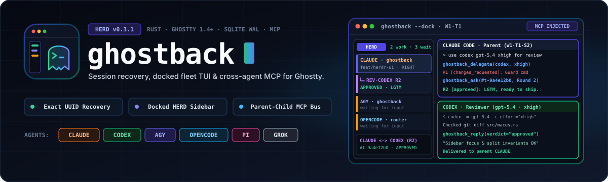
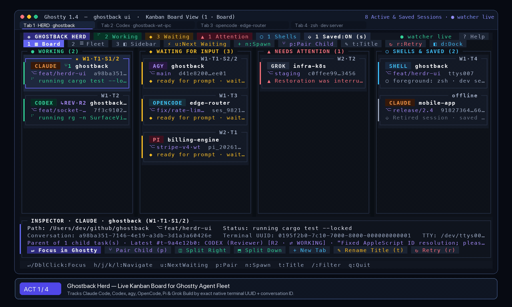

<p align="center">
  
</p>

<p align="center">
  <a href="https://github.com/cristipufu/ghostback/releases/latest"></a>
  <a href="https://github.com/cristipufu/ghostback/actions/workflows/ci.yml"></a>
  
  
  
  <a href="LICENSE"></a>
</p>

<p align="center">
  <a href="#quickstart">Quickstart</a> ·
  <a href="#what-it-solves">What It Solves</a> ·
  <a href="#workflows">Workflows</a> ·
  <a href="#cross-harness-mcp-orchestration">Parent ⇄ Child MCP</a> ·
  <a href="#cli--keybindings">CLI &amp; Keys</a> ·
  <a href="docs/architecture.md">Architecture</a>
</p>

<p align="center">
  
</p>

---

## What It Solves

Running 6–12 coding agents across Ghostty tabs and git worktrees breaks down in three places. **Ghostback** fixes all three in a single native binary—without `tmux`, Python/Node runtimes, or keystroke injection:

| Problem | How Ghostback Solves It |
| :--- | :--- |
| **1. Restarting Ghostty kills active agent sessions** | Joins each Ghostty `SurfaceView` UUID to the owning agent's TTY + OS process birth time. When Ghostty reopens, each restored shell claims and resumes its **exact conversation ID** (`claude`, `codex`, `agy`, `opencode`, `pi`, `grok`). |
| **2. Hunting through 10 tabs to find which agent is waiting** | `ghostback --dock` pins a 260px live **Herd Sidebar (`◈ HERD`)** on the left (or opens a full-screen **Kanban Board** / **Fleet Table**) with live tool telemetry, branch/worktree badges, and 1-click right-pane switching. |
| **3. Agents in different harnesses can't review each other** | Agents started from the docked UI automatically get the **`ghostback` MCP server**. Tell Claude *"use codex gpt-5.4 xhigh for review"*—Ghostback spawns Codex in a right-hand split and coordinates multi-round ping-pong until `approved`. |

---

## Quickstart

### Install via Homebrew (macOS)

```sh
brew install cristipufu/tap/ghostback
ghostback setup
ghostback --dock
```

### Build from Source

```sh
cargo build --release --locked
./target/release/ghostback setup
./target/release/ghostback --dock
```

`ghostback setup` installs the background capture LaunchAgent, `zsh`/`bash` prompt hooks, and agent lifecycle bridges (preserving existing hooks and JSONC comments). Open a new Ghostty tab after setup.

---

## Workflows

### 1. Dock the Live Fleet Sidebar (`ghostback --dock`)

```sh
ghostback --dock          # Dock ◈ HERD on the left (260px) of your active Ghostty tab
ghostback ui              # Full-window Kanban Board (1), Fleet Table (2), or Sidebar (3)
ghostback ui --demo       # Preview with an 8-agent sample fleet + Parent ⇄ Child task
```

- **Right-pane switching:** Clicking or pressing `Enter` on any card in the docked sidebar brings that terminal into the **right-hand workspace pane** while keeping `◈ HERD` docked on the left (`◉ RIGHT` badge).
- **Instant jump to blocked agents:** Press `u` or `Space` to jump straight to the next agent in `◆ WAITING` or `▲ ATTENTION`.
- **Safe spawning (`n` / `+New`):** Spawns new shells or agent harnesses in the right pane or a new docked tab—never cramping the narrow sidebar.

### 2. Cross-Harness Parent ⇄ Child Review (`p` or Natural Language)

Start a parent agent from `ghostback --dock` (via `+New` / `n`). Ghostback injects its stdio MCP server (`ghostback mcp`) into **that session only**—your normal standalone `claude` or `codex` runs outside the dock stay untouched.

Prompt the parent agent naturally:

```text
> Implement the socket framing changes, then use codex gpt-5.4 xhigh for review
  and ping-pong until he approves.
```

What happens under the hood:

```text
[Parent: Claude Code]
  │  1. Calls MCP `ghostback_delegate(child_agent="codex", role="reviewer",
  │                                   model="gpt-5.4", effort="xhigh", wait=true)`
  ▼
[Ghostback Herd Coordinator + SQLite Bus]
  │  2. Splits Ghostty right (`W1·T1·S3`) & launches:
  │     `codex --no-daemon -m gpt-5.4 -c model_reasoning_effort="xhigh" ...`
  ▼
[Child: OpenAI Codex (#t-9a4e12b0)]
  │  3. Inspects `git diff`, runs tests, calls MCP `ghostback_reply`:
  │     • Round 1 -> verdict: "changes_requested" ("Guard empty header block")
  ▼
[Parent: Claude Code]
  │  4. Wakes up with Round 1 feedback, patches code, calls MCP `ghostback_ask`:
  │     • Round 2 -> "Fixed in src/herd/mcp.rs:60 — please re-verify" (wait=true)
  ▼
[Child: OpenAI Codex (#t-9a4e12b0)]
     5. Verifies fix, calls MCP `ghostback_reply(verdict="approved")`
        Sidebar tree updates live: `└─ ↳ REV·CODEX R2 · ✓ APPROVED`
```

You can also drive delegation from the UI (`p` / `⑂Pair`) or directly from any shell:

```sh
# Spawn a child reviewer with inline @model [effort] shorthand and wait for Round 1
ghostback delegate --to codex --role reviewer --wait "@gpt-5.4 xhigh Review my current git diff"

# Send a Round 2 follow-up to the child agent and block until it replies
ghostback ask --task t-9a4e12b0 --wait "Fixed the edge case in src/macos.rs, please re-check"

# Inspect all active and completed parent-child tasks
ghostback tasks
```

### 3. Automatic Crash & Reboot Recovery

Run your agents normally (`claude`, `codex`, `agy`, `grok`, `pi`, `opencode`). When Ghostty restarts:

```text
Ghostty restores window/tab/split UUIDs
  ──► Shell prompt hook (`precmd` / `PROMPT_COMMAND`) fires in each pane
  ──► Acquires exclusive SQLite claim for that native terminal UUID
  ──► Launches exact resume command (`claude --resume <id>`, `pi --session <file>`, etc.)
  ──► Verifies fresh process/hook observation before marking `active`
```

If an attempt is interrupted or fails authentication, Ghostback **never** loops or guesses a conversation by directory—it marks the binding `▲ ATTENTION` and preserves the saved ID until you run `ghostback retry` (or press `r` in the UI).

---

## Cross-Harness MCP Orchestration

### Auto-Injected MCP Tools (`ghostback mcp`)

| MCP Tool | Role | Description |
| :--- | :--- | :--- |
| `ghostback_delegate` | Parent | Spawn a child `reviewer`, `worker`, or `advisor` in a Ghostty split (`claude`, `codex`, `agy`, `opencode`, `pi`, `grok`), optionally blocking until Round 1 completes. |
| `ghostback_ask` | Parent | Send a follow-up message to an existing child task (advances round `R1 → R2 → …`) and wait for the child's reply. |
| `ghostback_reply` | Child | Report findings back to the parent with `verdict` (`approved`, `changes_requested`, `comment`, `done`). |
| `ghostback_wait` | Either | Block until the other side posts a new message on the task. |
| `ghostback_tasks` | Either | List all Parent ⇄ Child tasks and latest round verdicts in the state store. |

### Model & Reasoning Effort Translation

Pass `--model` / `--effort` on the CLI, MCP arguments, or inline at the start of any prompt (`@<model> [effort] <goal>`):

| Harness | Model Flag | Reasoning Effort Flag |
| :--- | :--- | :--- |
| **Codex** (`codex`) | `-m <model>` | `-c model_reasoning_effort="<low\|medium\|high\|xhigh>"` |
| **Claude Code** (`claude`) | `--model <model>` | `--effort <low\|medium\|high\|max>` (`xhigh` maps to `max`) |
| **Grok Build** (`grok`) | `-m <model>` | — |
| **OpenCode** (`opencode`) | `-m <model>` | — |
| **Antigravity** (`agy`) | `--model <model>` | — |
| **Pi** (`pi`) | `--model <model>` | — |

---

## CLI & Keybindings

### Everyday CLI Commands

| Command | Description |
| :--- | :--- |
| `ghostback` / `ghostback ui` | Launch the interactive Ghostback Herd fleet board |
| `ghostback --dock` | Dock a live Herd sidebar (`◈ HERD`) on the left in Ghostty |
| `ghostback delegate --to <agent> "<goal>"` | Spawn a paired child reviewer/worker/advisor in a Ghostty split |
| `ghostback ask "<msg>" --wait` | Send a follow-up message to a child task and wait for its next turn |
| `ghostback reply --verdict <v> "<msg>"` | Send a child verdict (`approved`, `changes_requested`, `comment`, `done`) |
| `ghostback tasks [--json]` | List cross-harness Parent ⇄ Child tasks and message rounds |
| `ghostback status [--json]` | Inspect captured sessions, watcher health, and recovery outcomes |
| `ghostback retry [--terminal <uuid>]` | Arm interrupted/failed sessions for retry on the next shell prompt |
| `ghostback plan --json` | Inspect exact resume commands without executing them |
| `ghostback doctor` | Verify local binaries, hooks, and Ghostty integration |
| `ghostback setup` / `ghostback uninstall` | Install or cleanly remove shell/agent hooks (retains saved state) |

### Herd UI Keyboard & Mouse Controls

| Key / Action | Effect |
| :--- | :--- |
| `Enter` / Click (Sidebar) / Double-Click | Focus exact window, tab & split in Ghostty (or bring into right pane) |
| `j` / `k` / `↑` / `↓` / Mouse Wheel | Move selection down / up |
| `h` / `l` / `←` / `→` | Switch Kanban lane in Board view |
| `1` / `2` / `3` or `v` / `Tab` | Switch between **Board** (`1`), **Fleet** (`2`), and **Sidebar** (`3`) views |
| `u` / `Space` | Jump to and focus next `◆ WAITING` or `▲ ATTENTION` agent |
| `p` | Open **Pair Child Agent** modal (`Reviewer` / `Worker` / `Advisor`) |
| `n` | Open **Spawn Surface** modal (Split Right / Down / Tab / Window) |
| `t` | Set or clear native Ghostty terminal/tab title override |
| `r` / `R` | Arm retry for selected (`r`) or all (`R`) attention sessions |
| `c` | Copy exact shell-quoted resume command to macOS clipboard |
| `/` | Live fuzzy filter by project, git branch, agent, or conversation ID |
| `a` / `s` / `g` / `w` | Toggle Agents-only (`a`), Saved sessions (`s`), Sidebar grouping (`g`), Scan (`w`) |
| `d` / `?` / `q` | Dock sidebar (`d`), Help overlay (`?`), Close modal or quit (`q` / `Esc`) |

---

## Architecture & Guarantees

- **Identity is never guessed:** Ghostty's `GHOSTTY_SURFACE_ID` environment variable is a transient hex `u64`, whereas its persistent window-restoration key is the AppleScript `SurfaceView` UUID. Ghostback bridges the two via the owning agent's controlling TTY and `(pid, birth_time)` pair.
- **Transactional SQLite WAL state:** Stored locally in `~/Library/Application Support/Ghostback/state.sqlite3` (`0600`). Chat transcripts are never copied into Ghostback's database.
- **Zero-subprocess Git inspection:** The UI resolves `.git/HEAD` branches and linked git worktrees directly with bounded 4 KiB file reads so rendering stays instantaneous.
- **Standalone ~3.0 MB Rust binary:** Enforced `< 10 MiB` release size budget in CI across Apple Silicon (`macos-26`), Intel (`macos-15-intel`), and Linux (`ubuntu-latest`).

See [Architecture](docs/architecture.md), [User Experience](docs/user-experience.md), [Agent Compatibility](docs/agents.md), and [Verification](docs/verification.md) for deep technical details.

---

## Update or Uninstall

```sh
# Upgrade via Homebrew
brew update && brew upgrade ghostback && ghostback setup

# Uninstall hooks while keeping saved session history
ghostback uninstall
brew uninstall ghostback
```

## License

[MIT](LICENSE).
