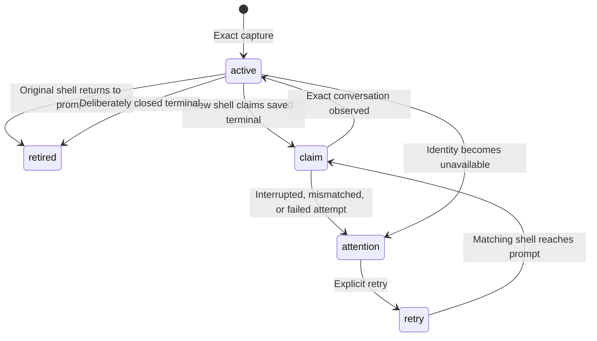

# Architecture

Ghostback has one job: reconnect an exact agent conversation to its original
native Ghostty terminal when a new shell is ready.

## Terminal and process identity

Ghostty 1.4 serializes its macOS `SurfaceView` UUID when saving native window
state. The AppleScript terminal `id` exposes that UUID. Ghostback stores it as
the terminal key and lets Ghostty own windows, tabs, splits, and layout recovery.

`GHOSTTY_SURFACE_ID` is a separate core identifier: a u64 formatted as hex.
It identifies the environment as Ghostty, but is never used as the persistent
terminal UUID. The owning agent's controlling TTY joins a hook to the native
terminal inventory; the hook subprocess itself can be detached and have no TTY.
An ambiguous join is rejected.

Process identities combine PID and OS process birth time, not PID alone. Reads
are checked against the owner again after resolving conversation metadata.
Directories, titles, transcript modification times, and selected tabs are never
conversation identity.

Ghostty source references checked at v1.4.0:

- [AppleScript API](https://ghostty.org/docs/features/applescript)
- [Native terminal ID](https://github.com/ghostty-org/ghostty/blob/v1.4.0/macos/Sources/Features/AppleScript/ScriptTerminal.swift)
- [UUID serialization](https://github.com/ghostty-org/ghostty/blob/v1.4.0/macos/Sources/Ghostty/Surface%20View/SurfaceView_AppKit.swift)

## Boundaries

| Module | Responsibility |
| --- | --- |
| `sessions` | Validated conversation model, exact resume commands, SQLite schema |
| `lifecycle` | Captures, restore claims, acknowledgement, retirement, retry |
| `agents` | Agent-specific interactive modes and replayable argument policy |
| `capture` | Owned-process registries, hooks, and incremental log adapters |
| `bridges` | Embedded agent-runtime bridges, configuration roots, comment-preserving TUI config edits |
| `native` | macOS PID/birth identity, ancestry, executable and argv inspection |
| `macos` | Ghostty inventory, TTY-to-UUID bridge, and AppleScript focus/split/title adapter |
| `applescript` | Native Ghostty AppleScript automation templates for focus, title overrides, and split/tab creation |
| `app` | Capture watcher, shell readiness, and agent launch orchestration |
| `herd` | Cross-harness Parent ↔ Child task/message store, turn waiting, and delegation pipeline |
| `herd::launch` | Per-session MCP config injection, model/effort flag translation, and harness launch builders |
| `herd::mcp` | Built-in stdio JSON-RPC 2.0 MCP server (`ghostback_delegate`, `ghostback_ask`, `ghostback_reply`, `ghostback_wait`, `ghostback_tasks`) |
| `ui` | Terminal raw-mode guard, background refresh loop, and native Ghostty effect execution |
| `ui::snapshot` | Fleet snapshot assembly, live process/tool classification, and zero-subprocess `.git/HEAD` inspection |
| `ui::demo` | Offline sample fleet and Parent ⇄ Child task data for `ghostback ui --demo` |
| `ui::canvas` | 2D truecolor cell buffer, synchronized ANSI renderer, and mouse hit-testing regions |
| `ui::input` | ANSI CSI/SS3 keyboard sequence and SGR mouse event parser |
| `ui::state` | Pure UI state machine, Sidebar tree grouping, and modal/view interaction handlers |
| `ui::render` | Board, Fleet, Sidebar, and Inspector view rendering onto `Canvas` |
| `ui::modals` | Spawn, Pair Child, Title Override, and Help modal rendering onto `Canvas` |
| `distribution` | Executable ownership and stable Homebrew path detection |
| `install` | Configuration planning, ownership, journaled setup, rollback, uninstall |
| `files` | Bounded reads, atomic configuration writes, exclusive helper locks |
| `process` | Subprocess deadlines, bounded nonblocking output, owned-child cleanup |
| `main` | CLI parsing and presentation |

The conversation model, storage, lifecycle, and parsing policies build on Linux.
Native restoration currently has a macOS adapter only. There is no tmux layer,
terminal-input injection, transcript copy, embedded interpreter, or network service.

## Capture contracts

| Agent | Evidence |
| --- | --- |
| Claude Code | Lifecycle hooks; per-PID session registry with startup timestamp |
| Codex | Lifecycle hooks bound through a dedicated `--no-daemon` TUI; unambiguous process-owned rollout metadata as fallback |
| agy | Lifecycle hooks; current conversation in its process-owned log |
| Grok Build | Active-session registry matching both PID and exact process birth time |
| Pi | In-process TUI extension, exact ID and absolute session-file path; bounded header validation |
| OpenCode | TUI plugin reading the selected route and matching session metadata |

The watcher samples every two seconds. Open-file discovery is cached for fifteen
seconds per process generation. agy logs are read incrementally; partial lines,
truncation, and rotation are handled explicitly. An empty selection is distinct
from missing evidence, so an old hook cannot revive a cleared conversation.

Only supported launch options are persisted. Prompts, one-shot commands,
previous resume targets, and arbitrary configuration arguments are not replayed.
Process environment values are not collected.

Codex's shared server can own several conversations without exposing their TUI
association. Setup therefore installs a PATH shim for interactive Codex inside
Ghostty. It adds `--no-daemon` and an ancestry-validated terminal hint. It preserves
normal aliases, models, and permission flags. Sessions started before this
integration can remain unresolved; the fallback never guesses by directory.

Pi and OpenCode emit selection changes through bounded child processes with
JSON on stdin, never through a shell. The bridge's claimed PID must match the
interactive process found through OS ancestry. Pi changes `process.title`,
which destroys kernel argv; the extension supplies its original in-process
argv, and Rust applies the same launch-option allowlist. Only those supported
options and the executable path reach storage.

Each UI observation includes a monotonic timestamp. SQLite serializes it with
capture or selection clearing, rejecting late callbacks from the same process.
The watcher reads these bindings for diagnostics and never recaptures stale UI
snapshots. Compare-and-update diagnostics cannot overwrite a fresh bridge
acknowledgement. Empty/unpersisted selection enters attention while preserving
the old identity. Shutdown events alone do not retire sessions.

Pi restoration checks a regular, non-symlink file's bounded first-line header
against its saved ID and directory before invoking `pi --session <file>`.
OpenCode uses `opencode --session <id>` in the selected session's directory.
No missing Pi file is passed to a CLI that could silently create a new session.

Native agent hooks use best-effort capture. Failures are visible in `status`
rather than agent prompt errors; managed hook commands also use `--quiet` to
contain malformed-input failures. `hook --strict` is available for diagnosis.
No successful exit code is treated as a restore acknowledgement without the
actual captured binding.

## Durable lifecycle

Claims are committed before launch using an immediate SQLite transaction.
Repeated readiness from the same shell cannot launch twice. An interrupted
claim observed by another shell requires explicit retry. A mismatched
conversation cannot overwrite the saved identity. Successful acknowledgement
clears the old claim, allowing later conversation switches.

Recovery runs synchronously from a generated zsh `precmd` hook or bash
`PROMPT_COMMAND`. This supplies an idle shell and inherited interactive stdio.
The direct parent must be that shell. A live saved owner or still-running
original shell prevents launch. No keystrokes are delivered to terminal apps.

A successful process exit alone is insufficient acknowledgement. A lifecycle
hook or fresh registry observation must confirm the exact conversation first.
Failed attempts preserve their IDs and enter `attention`, avoiding sign-in loops.
A delayed capture of an already-retired process cannot revive it.

Missing terminals are retired only after two observations in the same Ghostty
process generation. A helper restart or a new Ghostty process resets that
comparison, preserving recovery data across application shutdown.

## Persistence and installation

SQLite uses WAL, full synchronization, bounded busy waits, and transactions.
Schema v1/v2 recordings remain readable; a write upgrades transactionally to v3,
adding agent-specific string IDs, optional Pi file paths, and ordered UI
observations. Existing UUID identities are preserved.
Unknown newer schemas are refused before modification. State is local and its
new directory is private to the account.

Setup plans and validates every edit before application. It merges hooks, comment-preserving OpenCode plugin entries, and
managed configuration blocks, refuses unrelated executable ownership, and
records SHA-256 fingerprints. A write-ahead setup journal and private backups
allow recovery after interrupted application. The installed manifest is the
commit marker; a leftover committed journal is not rolled back. Rollback
preserves concurrent user changes and restores original file modes.

A nonblocking file lock admits one watcher and one installer per state directory.
Atomic writes use exclusive temporary files, synchronization, and rename.
Uninstall removes owned integrations, preserves modified files, and keeps
conversation state. Standalone CLI upgrades can be applied by rerunning setup.

Homebrew setup references the stable `opt/ghostback/bin/ghostback` link and never
copies or claims ownership of the Cellar executable. Standalone-to-Homebrew
migration removes old owned hooks and unchanged copies in the same journaled
transaction; modified user files survive. Deletions have rollback backups too.
The watcher checks for a changed Homebrew target between capture passes and
executes the new version. Its lock descriptor is close-on-exec so the replacement
can acquire the watcher lock. Uninstall leaves package removal to Homebrew.

## Extension rules

Add an adapter only when its conversation identity is tied to an owned process
or authenticated lifecycle event. Add fixtures for selection changes and stale
metadata. Keep OS effects outside the lifecycle policy. Avoid introducing a
plugin framework or background daemon protocol until a second real integration
requires one.

The foundation favors explicit responsibilities and small testable policies.
It does not claim a perfect architecture or exhaustive proof against failures
in Ghostty, agent versions, authentication, or the operating system. See
[verification](verification.md) for the evidence and remaining release checks.
